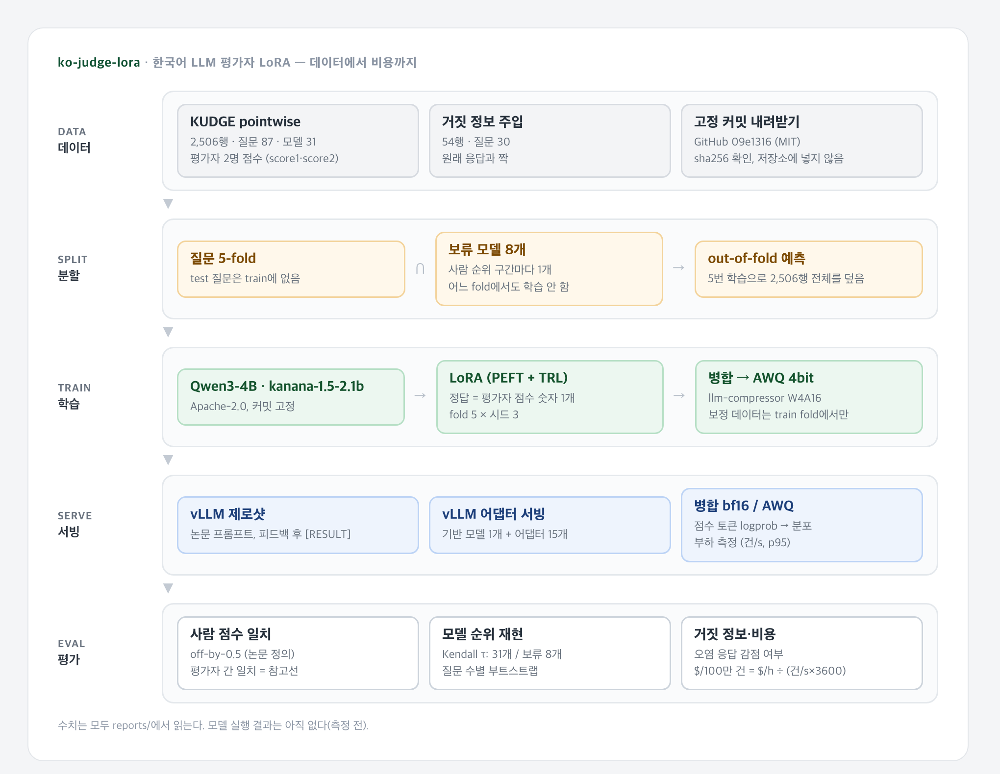

# 한국어 LLM 평가자 LoRA (ko-judge-lora)

[](https://github.com/parksungyun0411/ko-judge-lora/actions/workflows/ci.yml)   [](LICENSE)

한국어 응답을 1~5점으로 채점하는 소형 LLM 평가자(LLM-as-a-judge)를 사람 점수로 LoRA 학습하고, 사람 점수와 얼마나 맞는지와 평가 대상 모델들의 순위를 얼마나 재현하는지를 잽니다. 같은 평가자를 AWQ 4bit로 양자화한 뒤 vLLM으로 서빙해 양자화 전후의 품질 차이와 100만 건당 비용도 함께 봅니다.

데이터는 한국어 사람 평가 데이터셋 KUDGE([Son et al., 2024](https://arxiv.org/abs/2409.11239))입니다. 31개 모델이 87개 한국어 질문에 쓴 응답 2,506건에 평가자 두 명이 각각 점수를 매겼습니다. 학습용 분할이 없는 평가 전용 데이터라, 질문 단위 교차검증과 평가 대상 모델 보류로 학습·평가를 나눴습니다.

## 결과 요약

Kaggle 무료 T4 두 장에서 kanana-1.5-2.1b를 fp16으로 학습·서빙해 쟀습니다(질문 5-fold × 학습 시드 3, out-of-fold 2,506행). 실행 기록은 [docs/kaggle_t4.md](docs/kaggle_t4.md)에 있습니다. 판정 지표는 [reports/metrics/](reports/metrics/)에서, 결과 표 밖의 비교 수치(AWQ 점수 차이, 가중치 메모리 등)는 `make checks`가 저장소의 예측·로그 발췌에서 다시 내는 [reports/run_checks.json](reports/run_checks.json)에서 옮겼습니다.

- **사람 한 명과 맞는 정도가 사람끼리 맞는 정도와 비슷했습니다.** LoRA 판정과 평가자 개인 점수의 1점 이내 일치는 0.874~0.885, 피어슨 r은 0.623~0.650이었습니다(시드 3개). 평가자 두 명끼리는 0.838, 0.640입니다. 같은 모델의 제로샷은 0.293, 0.151이었습니다.
- **모델 순위를 재현했습니다.** 판정 점수로 매긴 31개 모델 순위와 사람 순위의 Kendall τ는 0.874(0.865~0.887)였고, 학습에서 응답을 한 번도 보지 못한 보류 모델 8개끼리는 0.857~0.929였습니다.
- **보류 모델에서는 정확도가 낮았습니다.** off-by-0.5 정확도는 학습에서 다른 질문의 응답을 본 모델 23개(1,852행)에서 0.687~0.699, 응답을 한 번도 보지 못한 보류 모델 8개(654행)에서 0.612~0.642였습니다. 보류 모델은 8개 한 벌로만 쟀으므로, 이 차이가 처음 본 모델이라서인지 그 8개 모델의 특성 때문인지는 나눌 수 없습니다.
- **거짓 정보는 거의 걸러내지 못했습니다.** 거짓 정보를 넣은 응답(54건)에 원래 응답보다 낮은 점수를 준 비율은 0.148~0.222였고, 78~83%에는 같은 점수를 줬습니다.
- **AWQ 4bit는 모델 순위를 지켰지만 점수를 낮게 줬습니다.** 병합 fp16과 비교해 31개 모델 순위 τ는 0.865에서 0.863으로 거의 같았고, off-by-0.5 정확도는 0.679에서 0.660으로 내려가 시드 3개의 최솟값(0.668)보다 낮았습니다. 같은 fold 병합 모델과 정수 점수가 달라진 707행 중 700행에서 AWQ가 더 낮은 점수를 줬습니다(평균 점수 2.04 → 1.74, 사람 평균 2.15).
- **T4에서는 프롬프트 처리 쪽에서 처리량이 막힌 것으로 보입니다.** 판정 출력은 1토큰이지만 프롬프트가 평균 1,875토큰([reports/gpu_budget.md](reports/gpu_budget.md)의 kanana 토크나이저 실측)이라, 병합 fp16 서빙이 동시 요청 32에서 0.73건/s(p95 52.7초)였습니다. AWQ는 가중치 메모리를 3.95GiB에서 1.34GiB로 줄였지만 처리량은 0.71건/s로 늘지 않았습니다. T4 시간당 $0.1069로 환산하면 100만 건에 병합 $40.59, AWQ $41.75입니다.

Qwen3-4B는 무료 GPU 시간 안에 돌리지 못해 측정하지 않았습니다(사유는 [reports/RESULTS.md](reports/RESULTS.md)).



## 구현 범위

- KUDGE 내려받기: GitHub 고정 커밋에서 받아 sha256 확인, 저장소에는 넣지 않음
- 데이터 확인 기록: 행·질문·모델 수, 점수 분포, 라이선스 근거, 논문 서술과 배포본의 차이([docs/kudge_verification.md](docs/kudge_verification.md))
- 분할: 질문 5-fold와 평가 대상 모델 8개 보류를 한 번의 학습으로 함께 만족시키는 out-of-fold 설계, 누수 여부 단위 테스트
- 판정 프롬프트 두 가지: 논문 부록 B의 생성형 프롬프트(제로샷), 점수 숫자 하나만 답하는 형식(LoRA)
- PEFT LoRA + TRL `SFTTrainer` 학습(정답은 평가자 개인 점수), 어댑터 병합, llm-compressor AWQ W4A16 양자화
- vLLM 서빙: 기반 모델에 LoRA 어댑터를 올려 시드·fold별 판정(`make eval-lora`는 한 서버에 15개, T4 커널은 fold마다 하나씩), 병합 모델과 AWQ 비교, 부하 측정
- 지표: 논문 정의의 off-by-0.5 정확도, 피어슨 r, 평가자 개인 점수와의 일치, 31개 모델 순위의 Kendall τ, 질문 수별 순위 안정성 부트스트랩, 거짓 정보 응답 감점 여부, 시드 3개 이상 구간
- 결과·비용 표 생성(`reports/RESULTS.md`), GPU 시간 추정(`reports/gpu_budget.md`)

## 아키텍처

학습과 평가는 같은 분할 위에서 돕니다.

| 구성 | 내용 |
|---|---|
| 질문 5-fold | 87개 질문을 5묶음으로 나눕니다. fold k의 test는 묶음 k 질문에 대한 모든 응답이고, 그 질문은 train에 나오지 않습니다 |
| 보류 모델 8개 | 사람 점수 순위를 8구간으로 나눠 구간마다 한 모델을 고릅니다. 이 모델들의 응답은 어느 fold의 train에도 들어가지 않습니다 |
| out-of-fold 예측 | 다섯 번 학습하면 2,506행 전체에 대해 질문을 처음 보는 상태의 예측이 생깁니다. 보류 모델의 예측은 질문과 모델을 모두 처음 보는 상태입니다 |
| 판정 형식 | 제로샷은 피드백을 쓴 뒤 `[RESULT] n`을 내고(논문 저장소와 같은 파싱), LoRA는 숫자 하나만 내며 그 토큰의 확률 분포에서 정수 점수(argmax)와 기댓값을 얻습니다. 결과 표는 두 방식 모두 정수 점수로 비교합니다 |

분할 결과(fold별 행 수, 보류 모델 목록)는 [reports/dataset_profile.md](reports/dataset_profile.md)의 마지막 표에 있습니다.

판정 모델은 상업 이용이 가능한 라이선스만 썼습니다. 2026-10-03에 모델 카드 메타데이터와 LICENSE 파일로 확인했고, 커밋 해시는 [configs/models.yaml](configs/models.yaml)에 고정했습니다.

| 모델 | Hugging Face | 라이선스 | 역할 |
|---|---|---|---|
| Qwen3-4B | `Qwen/Qwen3-4B-Instruct-2507` | Apache-2.0 | 처음 계획한 주 모델. 무료 T4 시간 안에 돌리지 못해 측정 안 함 |
| kanana-1.5-2.1b | `kakaocorp/kanana-1.5-2.1b-instruct-2505` | Apache-2.0 | 실제로 학습·서빙한 판정 모델 (T4, fp16) |

## 기술 스택

| 영역 | 기술 |
|---|---|
| 언어 |  |
| 학습 |     |
| 양자화·서빙 |   |
| 분석 |   |
| 코드 품질 |    |

학습·양자화 환경과 서빙 환경은 나눴습니다. vllm 0.30.0과 llmcompressor 0.14.0이 서로 다른 compressed-tensors 버전을 고정하기 때문입니다. 고정 버전은 [requirements/train.txt](requirements/train.txt), [requirements/serve.txt](requirements/serve.txt)에 있습니다.

## 실행 방법

로컬에서는 Python 3.12와 uv로 데이터 확인과 테스트까지 돌아갑니다.

```bash
make setup-dev
make data        # KUDGE 내려받기 (GitHub 커밋 09e1316, sha256 확인)
make profile     # reports/dataset_profile.{md,json}
make test        # 단위 테스트 + (torch가 있으면) 작은 랜덤 모델 학습 스모크
make lint
```

GPU 단계는 단계별 `make` 타깃으로 나눴습니다. 실제 실행은 Kaggle 무료 T4 두 장에서 kanana-1.5-2.1b로 했고, 커널 구성·단계별 소요 시간·실행 중 생긴 문제는 [docs/kaggle_t4.md](docs/kaggle_t4.md)에 있습니다. 커널 스크립트([docs/kaggle_t4/](docs/kaggle_t4/))는 `make` 타깃 대신 같은 모듈을 직접 불렀고, 어댑터 서빙은 fold마다 서버 하나에 어댑터 하나씩 올렸습니다(`make eval-lora`는 한 서버에 15개). 아래 표는 그 실행을 `make`로 옮긴 명령입니다. `make` 타깃 자체를 T4에서 돌리지는 않았습니다.

| 단계 | 명령 (kanana-1.5-2.1b, T4 fp16) |
|---|---|
| 제로샷 기준선 | `make zeroshot MODEL=kanana-1.5-2.1b VLLM_ARGS="--dtype float16"` |
| LoRA 학습 (fold 5 × 시드 3) | `make train-all MODEL=kanana-1.5-2.1b CONFIG=configs/t4/lora_kanana-1.5-2.1b.yaml` |
| LoRA 평가 | `make eval-lora MODEL=kanana-1.5-2.1b VLLM_ARGS="--dtype float16" PREC=fp16` |
| 병합·양자화 | `make merge-quant MODEL=kanana-1.5-2.1b MERGE_DTYPE=float16 QUANT_ARGS="--num-samples 32"` |
| 양자화 전후·부하 | `make eval-merged eval-awq MODEL=kanana-1.5-2.1b VLLM_ARGS="--dtype float16" GPU_NAME="Tesla T4"` |
| 결과·비용 표 | `make report GPU_NAME="Tesla T4" GPU_USD_PER_HOUR=0.1069 PRICE_NOTE=…` |
| 결과 표 밖의 비교 수치 | `make checks` (저장소의 예측·로그 발췌 → `reports/run_checks.json`) |

Qwen3-4B는 `MODEL=qwen3-4b`(bf16 GPU용 [configs/lora_qwen3-4b.yaml](configs/lora_qwen3-4b.yaml))로 같은 타깃을 쓰도록 계획만 했고 돌리지 않았습니다. 처음 계획은 RTX 4090 임대였습니다. 그 서버 준비 절차는 [docs/runpod_setup.md](docs/runpod_setup.md)에, RTX 4090 기준 GPU 시간 추정(토큰 수는 실측, 속도는 가정)은 [reports/gpu_budget.md](reports/gpu_budget.md)에 남겨 두었습니다. 이 경로로는 실행하지 않았습니다.

## 평가

### 데이터 (측정 완료)

아래 수치는 모델을 쓰지 않고 데이터만으로 계산했습니다. 모두 [reports/dataset_profile.md](reports/dataset_profile.md)(`make data profile`, GitHub 커밋 `09e1316`)에서 옮겼습니다.

| 항목 | 값 |
|---|---:|
| pointwise 응답 / 질문 / 평가 대상 모델 | 2,506 / 87 / 31 |
| 모델당 응답 수 | 72~87 |
| 모든 모델이 답한 질문 | 33 |
| 거짓 정보 주입 응답 (질문 30개) | 54 |

사람 간 일치(평가자 1 대 평가자 2, 2,506행)를 참고선으로 둡니다. 평가자 간 피어슨 0.640은 평가자 한 명과 다른 한 명의 상관이라, 판정 대 평균 점수의 피어슨(아래 결과 표)과는 비교 대상이 다르고 그 값의 상한도 아닙니다. 그래서 판정도 평가자 개인 점수와 같은 방식(완전 일치·1점 이내·피어슨)으로 따로 재서 이 값과 나란히 둡니다.

| 지표 | 값 |
|---|---:|
| 완전 일치 | 47.92% |
| 1점 이내 | 83.84% |
| 피어슨 r | 0.640 |
| 2점 차이 행 | 405 |
| 평가자 1 순위 대 평가자 2 순위 (31개 모델) Kendall τ | 0.901 |

off-by-0.5 정확도의 우연 기준선은 정수 1~5 균등 추측 27.18%, 항상 1점을 주는 상수 판정 43.10%입니다. 논문 Table 3 캡션의 무작위 기준선(30.86%)과는 다르며, 차이는 [docs/kudge_verification.md](docs/kudge_verification.md)에 적었습니다.

질문 수에 따른 사람 순위 안정성(질문 복원추출 부트스트랩 1,000회):

| 질문 수 | τ(87개 전체 순위 대비) 평균 | 95% 구간 | 1위 일치 |
|---:|---:|---:|---:|
| 10 | 0.826 | 0.742~0.893 | 47.80% |
| 30 | 0.896 | 0.840~0.943 | 60.00% |
| 87 | 0.939 | 0.904~0.970 | 79.30% |

질문 20개부터 τ 2.5 백분위가 0.8을 넘고, 시험한 질문 수(10~70, 87개) 가운데 0.9 이상인 것은 87개(0.904)뿐이었습니다. 평가자 1 순위와 평가자 2 순위의 τ는 실제 87개 질문 그대로는 0.901(위 표)이고, 질문 87개를 복원추출해 1,000번 다시 뽑았을 때의 평균은 0.867(95% 구간 0.817~0.914)입니다.

### 판정 모델 (측정 완료, Kaggle T4)

수치는 [reports/RESULTS.md](reports/RESULTS.md)(`make report`)에서 옮겼습니다. 시드 3개 행은 평균(최소~최대)입니다.

| 구성 | off-by-0.5 정확도 | 피어슨 r | τ (31개 모델) | τ (보류 8개) | 거짓 정보 감지율 | 건/s | p95 (ms) | $/100만 건 |
|---|---:|---:|---:|---:|---:|---:|---:|---:|
| kanana-1.5-2.1b 제로샷 | 0.1227 | 0.167 | 0.487 | 0.571 | 0.184 | — | — | — |
| kanana-1.5-2.1b LoRA fp16 (시드 3, 어댑터 서빙) | 0.6769 (0.6676~0.6844) | 0.707 (0.688~0.718) | 0.874 (0.865~0.887) | 0.881 (0.857~0.929) | 0.198 (0.148~0.222) | — | — | — |
| kanana-1.5-2.1b LoRA 병합 fp16 (시드 0) | 0.6788 | 0.716 | 0.865 | 0.857 | 0.204 | 0.73 | 52,717 | 40.59 |
| kanana-1.5-2.1b LoRA AWQ 4bit (시드 0, 보정 32개) | 0.6604 | 0.692 | 0.863 | 0.786 | 0.185 | 0.71 | 54,143 | 41.75 |
| Qwen3-4B (제로샷·LoRA·병합·AWQ) | 측정 안 함 | | | | | | | |

AWQ의 보류 8개 τ(0.786)는 병합(0.857)보다 낮지만, 8개 모델 28쌍 중 순서가 사람과 어긋난 쌍이 2쌍에서 3쌍으로 하나 늘어난 차이입니다.

제로샷은 2,506행 중 109행에서 `[RESULT]` 형식을 지키지 않았습니다(형식 실패를 오답으로 세면 0.1173). LoRA는 형식 실패가 0행입니다. `$/100만 건`은 T4 시간당 $0.1069(Colab 종량제 단가 × T4 소비율)로 환산했고, 측정은 무료 Kaggle에서 했습니다.

판정과 평가자 개인 점수의 일치(각 평가자와 따로 비교해 평균)는 사람 간 일치와 같은 척도입니다.

| 비교 | 완전 일치 | 1점 이내 | 피어슨 r |
|---|---:|---:|---:|
| 평가자 1 대 평가자 2 (참고선) | 0.479 | 0.838 | 0.640 |
| kanana-1.5-2.1b 제로샷 대 평가자 | 0.098 | 0.293 | 0.151 |
| kanana-1.5-2.1b LoRA 대 평가자 (시드 0·1·2) | 0.498~0.512 | 0.874~0.885 | 0.623~0.650 |

완전 일치와 1점 이내는 시드 3개 모두 사람 간 값보다 조금 높았고, 피어슨 r은 0.623~0.650으로 사람 간 0.640과 비슷했습니다. 이 비교는 구조적으로 판정에 유리하고(아래 '사람끼리의 일치를 참고선으로 둡니다') 차이의 구간도 재지 않았으므로 '사람보다 낫다'고 쓰지 않습니다.

표의 판정 지표는 모두 정수 판정 기준입니다. 제로샷은 `[RESULT]` 정수를, LoRA는 점수 분포의 argmax를 쓰므로 두 방식이 같은 해상도로 비교됩니다. LoRA의 기댓값(연속 점수)으로 낸 피어슨·순위 τ·거짓 정보 감지율은 `reports/metrics/*.json`의 `expected`에 따로 남습니다.

전체 표(측정 안 함 사유 포함)는 `make report`가 [reports/RESULTS.md](reports/RESULTS.md)로 만듭니다. 시드 묶음 칸은 평균(최소~최대, 시드 수)으로 나오고, 시드 간 t 구간은 `reports/metrics/*.json`에 남습니다. 지표 파일은 저장소의 예측(`outputs/predictions/`, 점수와 점수 분포만 있고 응답 본문은 없음)으로 `python -m ko_judge.evaluate run --tag …`를 다시 돌리면 같은 값이 나오고, 테스트가 이를 확인합니다.

비교용으로 논문이 발표한 수치를 인용합니다. 이 저장소에서 다시 잰 값이 아니며, 원문 표에서 옮긴 값은 [configs/paper_reference.yaml](configs/paper_reference.yaml)에 있습니다.

| 출처 (arXiv:2409.11239v2) | 판정 모델 | pointwise 정확도 | 피어슨 r |
|---|---|---:|---:|
| Table 3, 5쪽 | GPT-4o | 61.26% | 0.62 |
| Table 3, 5쪽 | Qwen2-7B-Instruct | 24.03% | 0.20 |
| Table 3, 5쪽 | Qwen2-1.5B-Instruct | 13.65% | 0.11 |
| Table 5, 7쪽 | Prometheus2-7b (영어 판정 데이터로 학습) | 46.46% | 0.43 |

학습 없는 kanana-1.5-2.1b 제로샷(0.1227)은 같은 조건의 소형 모델인 Qwen2-1.5B-Instruct(13.65%)와 비슷한 범위였습니다. 평가 행이 논문과 똑같다는 보장은 없습니다(한계의 사람 점수 잡음 항목). LoRA 결과는 같은 데이터 분포로 학습한 판정이라 논문 수치와 같은 조건의 비교가 아닙니다.

## 프로젝트 구조

```text
ko-judge-lora/
├── src/ko_judge/
│   ├── data.py, profile.py        KUDGE 내려받기·확인, 데이터 프로파일
│   ├── splits.py                  질문 5-fold + 보류 모델
│   ├── prompts.py, parsing.py     판정 프롬프트, [RESULT] 파싱·점수 분포
│   ├── train_lora.py, merge.py    LoRA 학습, 어댑터 병합
│   ├── quantize.py, compat.py     AWQ W4A16, kanana 설정 검증 우회
│   ├── generation.py, predict.py  vLLM·transformers 판정
│   ├── metrics.py, ranking.py     일치도, Kendall τ, 순위 안정성 부트스트랩
│   ├── evaluate.py                out-of-fold 지표, 시드 묶음
│   ├── loadtest.py, cost.py, budget.py  부하 측정, 결과·비용 표, GPU 시간 추정
│   └── run_checks.py              저장소의 예측·로그 발췌에서 결과 표 밖의 비교 수치
├── configs/      판정 모델(라이선스·커밋 고정), LoRA 설정, 결과 표 구성, 논문 인용 수치
├── scripts/      GPU 서버 초기 설정, vLLM 실행 래퍼
├── outputs/      판정 예측(점수·점수 분포만)과 학습 요약. 가중치와 전체 로그는 넣지 않음
├── reports/      스크립트가 만드는 결과 (데이터 프로파일, GPU 추정, 판정 지표, 부하 측정, 결과 표, 비교 수치)
├── requirements/ 학습·서빙 환경 고정 버전
├── docs/         KUDGE 확인 기록, Kaggle T4 실행 기록·커널 스크립트·로그 발췌, GPU 임대 계획(실행 안 함), 다이어그램(HTML·PNG)
└── tests/        pytest (실제 KUDGE, 합성 데이터, 가짜 판정 모델, 작은 랜덤 모델)
```

## 구현하면서 신경 쓴 점

- **질문과 모델 두 방향으로 누수를 막았습니다.** 같은 질문에 대한 다른 모델의 응답을 학습에서 보면 그 질문의 채점 감각을 외울 수 있고, 같은 모델의 다른 응답을 보면 모델 문체로 점수를 짐작할 수 있습니다. train = (그 fold 밖 질문) ∩ (보류 밖 모델)로 두 조건을 한 번의 학습에서 함께 만족시키고, 모든 fold에서 겹침이 없다는 것을 실제 데이터로 테스트합니다.
- **정답은 평균 점수가 아니라 평가자 개인 점수입니다.** 평균은 0.5 단위라 정수 판정과 맞지 않습니다. 행마다 두 평가자 중 한 명의 점수를 시드로 골라 정답으로 둡니다.
- **제로샷과 LoRA를 같은 해상도로 비교합니다.** LoRA는 점수 토큰의 확률 분포가 있어 기댓값(연속 점수)을 낼 수 있지만, 제로샷은 정수만 냅니다. 연속 점수는 해상도만으로 피어슨이 유리해지고, 동점이 없어 구분 능력이 없는 판정도 거짓 정보 감지율이 약 50%가 됩니다. 그래서 결과 표는 LoRA도 argmax 정수로 내고(거짓 정보는 동점이면 미감지, 동점 비율을 함께 기록), 기댓값 지표는 따로 남깁니다.
- **논문 지표를 그대로 쓰되 약점을 같이 적습니다.** off-by-0.5 정확도는 논문 저장소 코드와 같은 식으로 계산하고 형식 실패를 뺀 값과 포함한 값을 모두 남깁니다. 다만 항상 1점을 주는 판정도 43.10%가 나오는 지표라, 피어슨 r과 순위 τ를 같이 봅니다.
- **사람끼리의 일치를 참고선으로 둡니다.** 판정과 개별 평가자의 일치(완전 일치·1점 이내·피어슨)를 평가자 1 대 평가자 2와 같은 방식으로 재서 나란히 놓았습니다. 다만 판정은 두 평가자의 점수를 섞어 학습하므로 두 사람의 공통 경향을 맞히게 되고, 평가자 오차가 서로 독립이라면 개인 평가자와의 일치에서 평가자끼리보다 구조적으로 유리합니다. 그래서 참고선을 넘어도 사람보다 낫다는 뜻은 아니고, 차이의 구간도 재지 않았으므로 비슷한 범위였다고만 적습니다. 평균 점수에는 평가자 자신의 점수가 들어 있어 평가자 한 명도 평균과는 상관이 높게 나오므로, 판정 대 평균 점수의 피어슨은 0.640과 직접 비교하지 않습니다.
- **순위 안정성 부트스트랩은 새로 썼습니다.** [rag-eval-harness](https://github.com/parksungyun0411/rag-eval-harness)의 `rankstab` 모듈과 같은 방식입니다. 질문을 복원추출해 순위를 다시 매기고 전체 순위와의 Kendall τ-b를 봅니다. 다만 그 모듈은 시스템 × 질문 점수 행렬에 빈칸이 없다고 전제하는데, KUDGE는 모델마다 답한 질문이 달라(전 모델 공통 33개) 그대로 넣을 수 없습니다. 이 저장소를 만들 때는 그 저장소가 공개 전이라 CI에서 설치할 수 없어 의존성으로 넣지 않았고, 빈칸을 허용하는 형태로 다시 구현했습니다. Wilson 구간 함수는 같은 식을 복제했습니다.
- **kanana 설정 문제를 우회했습니다.** transformers 5.17·5.18은 hidden 크기가 head 수로 나눠떨어지지 않는 설정을 거부해 kanana-1.5-2.1b를 불러오지 못합니다. head_dim이 명시된 경우에만 검사를 건너뛰는 패치(`compat.py`)를 학습 프로세스와 vLLM 플러그인 양쪽에 걸었습니다. 학습 프로세스 쪽은 T4에서 열다섯 번 학습이 끝난 것으로, vLLM 쪽은 T4에서 어댑터·병합 모델을 서빙해 판정이 끝나는 것으로 확인했습니다. 패치 단위 테스트(`tests/test_compat.py`)는 transformers가 있는 환경에서만 돌고 CI에서는 건너뜁니다.
- **양자화 메모리 부족을 프롬프트를 자르지 않고 풀었습니다.** AWQ 보정이 샘플 256개에서 T4 15GB를 넘었습니다. 길이를 2,048토큰으로 자르면 샘플의 35%에서 끝의 정답 점수가 잘려 판정 형식과 다른 텍스트로 보정하게 됩니다. 그래서 길이 상한(4,096토큰, 잘리는 샘플 0.5%)은 두고 샘플 수를 줄였습니다. 64개도 넘쳐 32개로 돌렸고, fold별 보정 토큰은 6.2만~6.8만 개로 AWQ 저자 구현의 보정량(128개 × 512토큰 = 65,536)과 비슷합니다. 이 항목의 토큰 수는 같은 표본 추출을 kanana 토크나이저로 로컬에서 다시 센 값이고, 센 결과 파일은 저장소에 없습니다.
- **병합 모델이 맞는 fold인지 예측으로 확인했습니다.** 커널 스크립트의 bash 변수 펼침 순서 때문에 병합 모델이 fold 번호와 다른 이름의 폴더에 저장됐습니다. 순서상 판정한 모델은 맞았지만 추정으로 두지 않고, 같은 시드·같은 fold의 어댑터 판정과 병합 판정이 99.6~100% 같은 점수를 낸 것(시드가 다르면 68~82%)으로 확인했습니다. 경위는 [docs/kaggle_t4.md](docs/kaggle_t4.md)에 있습니다.

## 한계

- **판정 모델이 하나입니다.** Qwen3-4B를 돌리지 못해 모델 크기나 계열에 따른 차이는 모릅니다. 병합·AWQ는 학습 시드 0 하나로만 쟀습니다.
- **질문이 87개뿐입니다.** fold 하나의 test는 질문 17~18개이고 보류 모델 순위 τ는 8개 모델로 계산합니다. 사람 순위조차 질문 87개 전부를 써야 τ 2.5 백분위가 0.9를 넘으므로, 판정 모델 간 τ 차이가 작으면 구분할 수 없습니다. 채점 기준(rubric)은 지식×추론 유형 조합마다 공유되므로(논문 부록 A.1) 질문을 나눠도 같은 기준문이 train과 test에 함께 나옵니다.
- **논문의 결론을 넘어서는 주장을 하지 않습니다.** 논문은 영어로 학습한 판정 모델과 보상 모델이 추가 학습 없이 한국어 평가로 옮겨 간다고 결론 내렸습니다(9절. 6.2절 Table 5에서 영어 판정 데이터로 학습한 Prometheus2-7b의 정확도는 기반 모델 Mistral-7B의 20.29%에서 46.46%로 올랐습니다). 이 프로젝트는 반대 방향, 즉 한국어 사람 점수로 같은 데이터 분포 안에서 학습한 소형 모델을 잽니다. 영어 판정 모델과 직접 비교하지 않고(논문 수치 인용만), 학습한 판정은 같은 데이터셋의 다른 질문에 대해서만 평가하므로 다른 한국어 과제로 옮겨 가는지는 알 수 없습니다. 논문 수치는 KUDGE로 학습하지 않은 판정(제로샷 모델, 영어 판정 데이터로 학습한 Prometheus2 등)의 결과라서 이 프로젝트의 LoRA 결과와 같은 조건의 비교가 아닙니다.
- **사람 점수 자체에 잡음이 있습니다.** 배포된 2,506행 중 405행은 두 평가자가 2점 다릅니다. 논문 3.2절은 이런 행을 뺐다고 적었지만 배포본에는 남아 있고, 이 프로젝트도 그대로 씁니다.
- **거짓 정보 감지 정의는 이 프로젝트의 것입니다.** 오염된 응답의 점수가 원래 응답보다 낮으면 감지로 세고, 동점은 감지가 아닙니다. 논문은 피드백 글을 사람이 읽고 판단했으므로(7절) 수치를 직접 비교할 수 없고, 표본은 54건입니다.
- **처리량과 비용은 T4 조건의 값입니다.** 부하 측정은 fold 0 모델, 동시 요청 32, 1,000건이고, 측정 중 같은 커널의 다른 GPU에서 학습이나 양자화가 돌았습니다. T4에서 vLLM 0.30.0은 TRITON_ATTN 백엔드를 썼고 프롬프트 처리 속도는 중앙값 초당 약 1,250토큰이었습니다. prefill과 decode 시간은 따로 재지 않았습니다. 다른 GPU에서는 처리량과 비용이 크게 다를 수 있습니다.
- **AWQ 보정 샘플이 32개입니다.** T4 메모리 때문에 줄인 값이고, 보정 샘플을 늘렸을 때 점수가 낮아지는 치우침이 줄어드는지는 확인하지 못했습니다. 서빙 설정도 최대 길이·메모리 비율·dtype 말고는 vLLM 기본값으로 두었습니다.
- **fp16으로 학습했습니다.** 원래 설정은 bf16이지만 T4에 bf16이 없어 fp16으로 학습했습니다. 열다섯 번 학습이 모두 끝까지 돌았고(학습 손실 0.570~0.671) 판정 형식 실패도 0행이었지만, bf16 학습과 직접 비교하지는 않았습니다.

## 라이선스

코드는 [MIT](LICENSE) 라이선스를 따릅니다. KUDGE 평가 파일은 GitHub `guijinSON/kudge`에 MIT로 배포되어 있지만, 응답 본문이 31개 모델의 출력이라 저장소에는 넣지 않고 `make data`로 고정 커밋에서 내려받습니다. HF에만 있는 원 주석 파일은 라이선스 표기가 없어 데이터 프로파일에만 씁니다. 판정 모델 가중치는 각 모델의 라이선스(Apache-2.0)를 따릅니다. 근거는 [docs/kudge_verification.md](docs/kudge_verification.md)에 있습니다.
